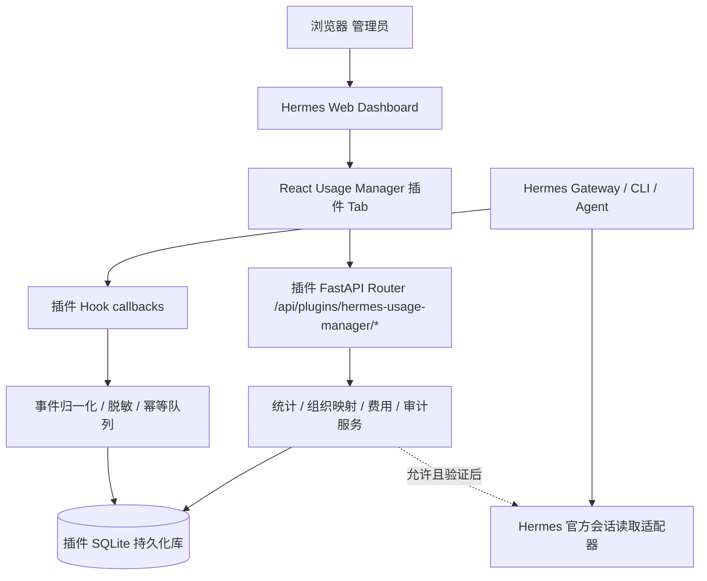

# Hermes Usage Manager

## 安装与独立端口（0.6.0）

用户已确认新增独立端口仅显示用量管理平台，不显示Hermes外壳。原生Dashboard/Agent Hooks仍保留；独立入口共用业务API和SQLite，但有自己的React构建与管理员登录，不要求打开9119。

```bash
hermes plugins install https://github.com/ZhongJiating26/HermesUsageManagerDashboard.git
bash ~/.hermes/plugins/hermes-usage-manager/install.sh
```

Linux用户systemd环境执行第二条安装引导后，只需输入两次管理员密码；脚本自动寻找Hermes的Python、创建私有数据目录、保存数据库与采集配置，并启动独立后台服务。默认访问http://127.0.0.1:9120；已有密码、数据和相同服务配置会保留。最后按原方式重启Gateway使配置生效，无需手动export变量；已有Gateway环境变量仍优先，旧DB配置需先调整。不会修改Gateway或开放公网。完整说明、非systemd环境及自定义配置见[独立端口使用说明](docs/standalone.md)。安装引导与0.6.0独立入口仍待目标机验证，以下M4验收是0.5.1历史基线。

## 原始开发规格与历史验收

M3已提交`61b7663`并在Hermes v0.21.0基础验收通过。0.5.1已完成现有测试机升级、代码回退、恢复新版及可恢复移出/重装验证，原数据库保留；本地标签v0.5.1指向57cf045，严格交付包已生成。用户免除全新服务器验收（未验证），按调整范围M4完成，非生产部署批准。当前验收矩阵见docs/m4-acceptance.md；安装配置与安全边界见docs/deployment.md、docs/configuration.md、docs/security-review.md，旧阶段结果保留为历史。

> **版本**：V1.0（2026-10-15）  
> **项目代号**：`hermes-usage-manager`  
> **交付对象**：Codex / 开发团队  
> **状态**：开发规格，不代表代码已实现或已通过真实 Hermes 集成测试  
> **实施策略**：本地开发（Mock）→ 本地 Hermes 兼容验证 → 测试服务器 → 生产部署

> **v0.21.0兼容预检修正（0.4.1）**：按用户实机输出，当前包仅声明/注册五个可用Hook，辅助用量明确未采集；只读会话按旧签名有界读取。未升级Hermes、未覆盖旧插件，doctor和真实事件尚待验证；优先见 [兼容记录](docs/compatibility.md) 和 [新测试步骤](docs/m3-testing.md)。下列0.4.0结果为历史。

> **历史实现记录（M3 / 0.4.0，不代表当前状态）**：当时实现六Hook适配并仅完成本地验证；后续按目标v0.21.0调整为五个可用Hook，辅助用量明确未知。当前M3基础验收已通过，M4进展以上方摘要、[验收矩阵](docs/m4-acceptance.md)及[兼容记录](docs/compatibility.md)为准。设计与早期过程保留于 [M3设计](docs/m3-design.md)、[阶段报告](docs/m3-report.md)。

## 0. 给 Codex 的执行原则（必读）

你是这个项目的执行开发者。**不要只做页面演示；需实现可安装的 Hermes Web Dashboard + Agent Hook 组合插件。** 必须遵守：

1. 不修改 Hermes Agent 核心仓库；使用官方 `plugin.yaml` / `__init__.py` 生命周期 Hook、`dashboard/manifest.json`、`dashboard/plugin_api.py` 扩展机制。
2. 使用 **React + TypeScript + Vite（或经验证可生成 IIFE 的 esbuild）+ Apache ECharts**；用户已选择 React，不使用 Vue 3。
3. 最终运行在 **Hermes Web Dashboard（`hermes dashboard`）** 内；不是 Hermes Desktop Plugin SDK；不得误用 `@hermes/plugin-sdk`（这是桌面插件 SDK）。
4. 原生Dashboard发布产物必须包含 `dashboard/dist/index.js`（普通 `<script>` 加载的 **IIFE**）及CSS，**不得将 React 或 ReactDOM 重复打包到该入口**，继续使用 `window.__HERMES_PLUGIN_SDK__.React`。用户后续明确授权的独立端口入口单独构建React/ReactDOM，不加载原生IIFE或Hermes外壳；两种构建相互隔离。
5. 使用用户提供的 `references/` 原型图，优先还原布局与交互；样式要求 Material Design 3（浅紫低饱和），不可默认套用宿主暗黑样式或全局覆盖宿主主题。
6. 插件后端使用 Hermes Dashboard 内置的 FastAPI 插件路由，**不要求单独启动 FastAPI 服务**。本地测试可用独立测试 app 承载同一个 router，但部署生产时不启动它。
7. 第一版用 **SQLite**，持久化数据写入 Hermes 提供的插件数据位置或显式配置的安全持久化路径；**不得写入可被插件更新覆盖的源码/安装目录**。
8. **绝不在本地开发阶段连接或改动用户的生产 Hermes 服务器**。Mock 模式必须独立运行；真正安装部署需独立阶段、单独验收。
9. 真正取不到的数据，要返回 `null` / `unavailable` / 明确错误，不得用 0 或模拟数据伪装为真实数据。展示 Mock 时必须有显著的“模拟数据”标识；生产模式禁止静默回退到 Mock。
10. 每一开发阶段结束运行相应测试并汇报：完成项、变更文件、命令与输出、尚存风险，未经必要兼容性核对不得直接宣布可用于生产。
11. 若官方接口与本文示例存在差异，**以当前目标 Hermes 版本文档和源码为准**，在 `docs/compatibility.md` 记录差异及证据；不要靠猜测发明官方 SDK 方法。
12. 默认不实现直接操控 Hermes Runtime 的高风险能力（例如重启 Gateway、任意文件访问、修改 MCP 授权、读取其他员工密钥）；本项目第一版是**可观测性、统计、审计与独立人员映射配置**。

---

## 1. 产品定位和交付目标

### 1.1 产品定位

为运行 Hermes Agent 的企业或个人部署一个即装即用的「用量管理」插件，提供 Token 消耗、费用、活跃用户、部门分摊、模型与服务商分布、MCP 使用、单次模型请求明细、会话审计、人员与部门映射等能力。支持飞书接入和未来多 Profile 场景。单机先行；跨服务器集中聚合不在 V1 核心范围内。

**使用对象**：Hermes 实例管理员、获授权的部门管理人员、审计人员。**数据范围**：当前安装实例所能合法采集和查询的 Hermes 运行事件；不默认代表企业全部 Hermes 服务器。

### 1.2 必须交付的成果

- [ ] 符合 Hermes 原生插件目录规范的源代码仓库，包含 `plugin.yaml`、`__init__.py`、`dashboard/manifest.json`、`dashboard/plugin_api.py`。
- [ ] `frontend/` React + TypeScript 源码；`dashboard/dist/index.js` 和 CSS 的可复现构建脚本（发布包包含预构建文件）。
- [ ] 本地 Mock 宿主、Mock API、统一 fixtures（模拟请求、会话、部门、用户、工具等）。
- [ ] 原型对应的所有页面和交互，包括必要的空状态、错误态、加载态、分页与筛选。
- [ ] ECharts 通用图表封装、对紫色主题的完整适配。
- [ ] Hermes Hook 适配层；标准化模型调用与工具事件，幂等写入 SQLite；数据质量与缺失数据提示。
- [ ] FastAPI 查询/管理接口、数据库迁移、可追溯统计口径与角色访问控制机制。
- [ ] 单元、API、前端交互、构建、模拟集成测试；提供真实 Hermes 兼容测试清单。
- [ ] `README.md` 安装/使用说明、`docs/development.md`、`docs/deployment.md`、`docs/compatibility.md`、`docs/privacy.md`、`CHANGELOG.md`。
- [ ] 可在全新兼容 Hermes 测试环境中安装、运行、升级并保留历史数据；有回滚与卸载说明。

### 1.3 V1 功能边界

**P0，必须可用**：概览、使用分析、MCP 分析、用量明细、对话审计列表、人员设置（用户列表/部门列表/部门分配）、本地配置页与基础模型价格管理、基础统计 API、Hooks 采集、Mock 演示、真实 Hermes 测试安装。

**P1，建议在首版一起实现**：会话详情（消息按时间展示、连续工具调用合并折叠）、CSV 导出、数据补录（限稳定/验证过的 API）、模型价格历史版本、访问审计、手动用户与飞书 ID 映射。

**暂不实施**：跨服务器中央控制台、直接变更 Hermes Profile 及 Gateway 配置、复杂消费限额与拦截、修改 MCP 权限、企业 SSO 自动组织同步、存储所有完整原文/工具原始结果、自动浏览其他 Profile 私有文件、K8s 部署。

### 1.4 用户原型和差异处理

图片位于 `references/`：

| 原型图片 | 实现页面 | 备注 |
|---|---|---|
| `概览.png` | 概览 | KPI + 趋势 + 分布 + Top 排行 |
| `使用分析.png` | 使用分析 | 部门筛选 + 双轴图 + 两饼图 + 排行 |
| `MCP分析.png` | MCP 分析 | MCP 服务筛选 + 调用面积趋势 + 排行 |
| `用量明细.png` | 用量明细 | 逐次模型请求表，状态和模型标识 |
| `对话审计.png` | 对话审计 | 会话列表 |
| `对话审计-对话详情.png` | 列表与右侧详情抽屉 | 按用户最新确认原型还原，与`对话详情.png`共同定义布局 |
| `对话详情.png` | 详情抽屉放大图 | 顶部摘要、左右气泡、长文展开、独立滚动及两级工具折叠 |
| `人员设置-用户列表.png` | 人员设置 / 用户列表 | Open ID、姓名、部门 |
| `人员设置-部门分配.png` | 人员设置 / 部门列表 | 部门数和人数、编辑/删除 |
| `人员设置-部门分配-1.png` | 人员设置 / 部门分配 | 双列表迁移/调配 |

**原型视觉优先**：不擅自增加大型仪表盘卡片，不重排整体信息架构。没有独立原型的模型设置、会话详情采用本规格推荐方案，并在源代码注释/设计文档标明“补充设计”。图上的人员与数据均为示例，不能硬编码成业务结果。

---

## 2. Hermes 官方可扩展能力及约束（实施前须复核目标版本）

本规格依据 2026-10-15 查阅的官方文档；Hermes 迭代较快，Codex 必须确认实际测试环境的 CLI 版本和源码/API 兼容性。

| 机制 | 官方约束 / 用途 | 官方地址 |
|---|---|---|
| Python Agent 插件 | `plugin.yaml` + `__init__.py`，`register(ctx)` 注册 Hook | https://hermes-agent.nousresearch.com/docs/developer-guide/plugins |
| Hook | `post_api_request`、`api_request_error`、`post_tool_call`、`pre_llm_call`、`post_auxiliary_call` 等 | https://hermes-agent.nousresearch.com/docs/user-guide/features/hooks |
| Web Dashboard 插件 | `dashboard/manifest.json` + IIFE bundle，通过 `__HERMES_PLUGINS__.register(...)` 注册页面 | https://hermes-agent.nousresearch.com/docs/user-guide/features/extending-the-dashboard |
| Dashboard API 插件 | `dashboard/plugin_api.py` 导出 `router = APIRouter()`，挂载在 `/api/plugins/<name>/` | 同上 |
| Dashboard SDK | `window.__HERMES_PLUGIN_SDK__` 提供宿主 React、hooks、shadcn 基元和 API | 同上 |
| 数据持久化 | `plugin_data_dir(name)`、`plugin_db(name)`；数据随 Profile / Hermes Home 范围变化 | https://hermes-agent.nousresearch.com/docs/developer-guide/plugins |
| 检查安装 | `hermes plugins doctor`、`validate`、`install` / `enable` 等 CLI | 同上 |
| Dashboard 安全 | 本地 loopback 默认不强制登录；非 loopback 需要认证；共享管理平台另需独立 RBAC | https://hermes-agent.nousresearch.com/docs/user-guide/features/web-dashboard |

### 2.1 不可混淆的机制

1. `hermes dashboard`（Web Dashboard）插件与 `hermes desktop` 插件是**两种不同 SDK**。
2. Dashboard 发现 UI 的 `rescan` 不代表 Python API 热更新。**插件 API 路由需要重启 Dashboard 重新挂载**。
3. 插件前端是注册到宿主的 React **组件**，不是另起一个 React SPA 服务，也不是直接 `createRoot()` 覆盖宿主 DOM。
4. Dashboard Auth 只能表明访问者通过了宿主认证，并不自动具备“哪个飞书员工/部门”的应用内授权；服务端务必有身份和 RBAC 方案。未完成可靠身份绑定时，敏感审计页面只能管理员访问。
5. `post_tool_call` 采集所有工具，不是所有工具都属于 MCP。只能经过工具注册/元数据或已验证规则识别为 MCP，无法识别的列为 `other/unknown`，不得计入 MCP 榜单。
6. `post_auxiliary_call` 的流式场景可能没有及时产生 usage，需标记用量不可用；不默认按 0 计费。
7. 可观察 Hook 在不同版本字段可能有变化，适配器应对可选字段容错并明确测试版本。

### 2.2 插件兼容策略

- 在 `docs/compatibility.md` 记录：Hermes 版本/Commit、Python、Node、本地 OS、插件验证结果、关键 API 字段实测样例（脱敏）。
- 第一个里程碑使用最小 IIFE + FastAPI `/health` + Hook `register(ctx)` 完成闭环，再开发大量功能。
- 旧版 Hermes 缺失某个 Hook 时明确标记能力不可用，不允许通过猜测内部导入位置伪造兼容。
- 对 Hermes 内部导入（如 SessionDB）一律封装在 `adapters/`；优先使用公开/文档化接口；内部模块变更不应波及业务层。

---

## 3. 技术架构与运行时边界



### 3.1 本地与生产两套运行方式

| 能力 | 本地 Mock 开发 | Hermes 插件生产模式 |
|---|---|---|
| UI | 本地独立预览 React 页面，用 React dev/mock 宿主 | 注册 Hermes Dashboard Tab |
| React 依赖 | 本地 dev 测试可用 npm react/react-dom | **使用宿主 SDK.React，不打包 React/ReactDOM** |
| API | Mock Service Worker 或测试 FastAPI + SQLite fixture | Dashboard 插件 FastAPI Router |
| Hook | 测试代码主动回放 fixture | `register(ctx)` 订阅真实 Hook |
| 身份 | 测试管理员/审计员/部门管理员角色 | 宿主认证 + 插件自身角色检查 |
| 数据 | `data_source=mock`，页面明显水印 | `data_source=live`，禁止静默 Mock |

生产不应要求部署 React Dev Server、Node、独立 FastAPI、单独 Nginx、PostgreSQL、Redis；这些最多是开发或未来增强功能。

### 3.2 跨进程与多 Profile（务必实现数据边界）

同一服务器上可能有多个 Hermes Profile / Gateway 进程。Python Hook 采集器可能处于不同进程、不同 Profile；Dashboard 跑在另一个进程。`plugin_db()` 默认随当前 Profile 的存储根路径变化，**不代表多个 Profile 的数据会自动合并**。

实现**共享数据库路径显式配置**的存储接口：

- `USAGE_MANAGER_DB_PATH`（可选）：管理员为本 Hermes 实例指定**可访问、受保护**的共享 SQLite 绝对路径。可以汇聚同一主机多 Profile 事件；存储路径及所有者必须可验证，不能让普通 UI 用户随意改写。
- 不配置时使用 `plugin_db("hermes-usage-manager")` 的默认 Profile 作用域；在 UI 标明 **当前 Profile 数据范围**，不能把它显示为“全员汇总”。
- 所有记录至少保留 `instance_id`、`profile_id`、`session_id`、`source_event_id`；跨 Profile 的 session ID / tool ID 不假定全局唯一。
- 多个进程共享 SQLite 时启用 WAL、`busy_timeout`、短事务、单 writer/队列或写入串行化及重试；经实测仍出现写锁竞争时，引入独立轻量写入代理或 PostgreSQL 适配器，不能靠无限重试阻塞 Hook。
- V1 只保证单主机聚合。跨机器同步属 V2（需新身份体系、TLS、队列/中心存储）。

### 3.3 数据流

1. Hermes 处理飞书/CLI 等输入，执行 Agent loop。
2. `pre_llm_call` 等事件提供会话上下文；`post_api_request` 提供成功请求和 usage；`api_request_error` 记录失败尝试；`post_tool_call` 提供工具完成记录。
3. Hook 回调**不存储原始 prompt 和完整工具结果**；快速提取有必要的结构化字段，写入有界本地队列/SQLite（必须避免明显降低 Hermes 对话性能）。
4. 数据规范化服务处理身份映射、Token 计算、模型价格匹配、MCP 工具解析、幂等去重。
5. 查询 API 返回聚合或分页列表，React 页面经筛选刷新 ECharts。
6. 会话原文若确需查看：按权限使用稳定 Session API 查询；与采集统计分离，不默认复制敏感原文。

---

## 4. 信息架构、布局与路由

### 4.1 导航层级

```text
Hermes Dashboard 顶层插件 Tab：“用量管理” (/usage-manager)
  ├─ 数据
  │   ├─ 概览                /overview
  │   ├─ 使用分析            /usage-analysis
  │   ├─ MCP 分析            /mcp-analysis
  │   ├─ 用量明细            /request-details
  │   └─ 对话审计            /conversation-audit
  │        └─ 会话详情       内部 detail state / modal/page
  └─ 配置
      ├─ 人员设置
      │    ├─ 用户列表       /people/users
      │    ├─ 部门列表       /people/departments
      │    └─ 部门分配       /people/assignment
      └─ 模型设置            /models
```

**路由边界**：Hermes 官方 manifest 只声明**一个** `/usage-manager` Tab；内部采用组件状态或可恢复的 query 参数切页，不依赖 Hermes 自身的未公开子路由注册能力，避免把完整 React Router SPA 强行接管宿主 URL。浏览器刷新后恢复插件默认首页或合法的 URL 状态。所有内部路由需要权限守卫。

### 4.2 总体布局

- 视觉参照原型：白色大背景，左侧浅薰衣草色圆角侧边栏，右侧内容区，统一浅紫色卡片与紫色操作控件。
- 插件只渲染**自身容器内**的侧边栏与内容区；不覆盖 Hermes 全局头部、原生导航与其他插件。
- 容器内：侧边栏宽 224–240px，内容区自适应，留白 20–32px；卡片圆角 16–20px；内容最大宽度约 1440px。
- 可根据 Hermes Dashboard 自身标准布局调整宽度：不强制整个宿主 `body` 出现额外最小宽度。窄屏左侧收起为内部 Drawer，表格横向滚动。
- 日期筛选：今天 / 近 7 天 / 近 30 天 / 自定义，统一定义时区，默认与实例配置时区一致；未配置时使用浏览器时区展示、UTC 存储，明确标注。
- 部门/人员/MCP 服务筛选器取真实权限范围内数据，必须支持“全部”、清除、空数据、加载以及变更后联动查询。
- 所有数据页图表与表格须有 Skeleton、空结果、请求失败与重试，拒绝“无数据=画一个 0 值漂亮图”。

### 4.3 页面与字段

#### A. 概览 `OverviewPage`

参考 `references/概览.png`。上方 3 组综合指标：

- **Tokens**：总量（大数字），输入未命中缓存、输入命中缓存、输出细分进度条/数字。
- **费用**：USD 总费用和分类费用；区分 `actual`（供应商账单）与 `estimated`（依据价格表估算）。
- **活跃人数**：选定周期内有有效活动的去重用户数量；主力模型按 Token 使用量最大定义，可切换以后扩展。

图表：
1. Token 消耗 / 活跃人数：双 Y 轴折线，X 轴日期。
2. 部门 Tokens：堆叠柱状图，缓存命中/未命中/输出；支持 Tokens/费用切换，费用需可归因。
3. 部门分布：饼图，Tokens/费用切换，显示值+比例。
4. 模型分布：饼图，Tokens/费用切换。
5. 服务提供商分布：饼图，Tokens/费用切换。
6. 用户排行：横向柱状图 Top 10，显示完整用量或缩写。

交互：点击部门/模型/用户可进入对应详情筛选；每个维度沿用顶部日期范围；图表 Tooltip 有原值、单位和比较基数。

#### B. 使用分析 `UsageAnalysisPage`

参考 `references/使用分析.png`。顶部：部门选择、时间选择。

- Token 消耗按天堆叠柱（输入命中、未命中、输出） + 活跃人数折线，独立 Y 轴。
- 人员用量分布饼图（人数较多时限制标签并提供 Legend/滚动）。
- 模型用量分布饼图（长模型名截断，Tooltip 保留全名）。
- 人员 Tokens 排行横向柱 Top 10。
- 未选择具体部门可统计权限范围内全部部门；支持点击跳转用量明细且携带 user_id 和范围。

#### C. MCP 分析 `MCPAnalysisPage`

参考 `references/MCP分析.png`。顶部：MCP 服务、日期范围。

- **MCP 调用趋势**：平滑折线面积图，单位“次”，按天聚合；允许按成功/失败过滤（P1）。
- **接口调用排行榜**：横向条形图，显示工具中文名/规范名、调用次数，滚动/分页适配工具较多情况。
- Tooltip 需至少提供：显示名、稳定工具标识、所属 MCP 服务器、调用次数、失败次数、耗时指标（有数据时）。
- 分类：仅可确认属于 MCP 的工具才计入；缺失工具注册元数据时提供“未识别工具”数据质量提示。

#### D. 用量明细 `UsageDetailsPage`

参考 `references/用量明细.png`。顶部：部门、用户、日期范围。

表格列：请求时间 + 状态、部门、用户、模型（供应商图标/标识）、输入未命中、输出、缓存读取、耗时。建议可展开/点击一行显示：请求 ID、Provider、Session、Turn、请求状态、费用、Token 分类、时间戳、错误代码（脱敏）。

- 默认按发生时间倒序；服务端分页，支持 page_size=20/50/100。
- 请求 `failed` 的 Token 可能未知，显示 `—` 或 `未知`；不伪作零。
- 价格未配置则 `estimated_cost_usd: null`；金额列标记为估算。
- 不暴露原始请求内容、API Key、完整响应消息。

#### E. 对话审计 `ConversationAuditPage`

参考 `references/对话审计.png`、`references/对话审计-对话详情.png` 和用户最新确认的 `references/对话详情.png`。

列表字段：会话 ID、部门、用户、会话开始时间、输入、输出、缓存读取、MCP 使用次数。服务端分页；基于身份授权搜索；点击会话进入详情。

**会话详情**（按用户最新确认原型还原）：

- 右侧抽屉保留背后会话列表，外层灰色遮罩且禁止滚动，移动端全宽；顶部关闭箭头及摘要固定，白色正文区域独立滚动，无消息分页控件，接近底部按需有界加载，关闭后恢复宿主滚动。
- 用户消息靠右、Hermes消息靠左，浅紫气泡，长文可展开/收起；工具分组采用灰底圆角容器，单工具为白色二级折叠。时间仅展示来源提供的有效时间，不以会话开始时间冒充消息时间。
- 仅已加载消息数可知时标为“已加载消息”；工具总数不可知时不把MCP次数当作全部工具次数。连续读取每次最多100条、单次查看最多5000条，达到上限明确提示后续未加载。缺失标题回退“对话详情”，未知Tokens展示破折号。

- 顶部摘要：Session ID、用户、部门、平台、Profile、开始时间、最近活动时间、总 Tokens、MCP 次数、状态。
- 时间线：用户消息、Hermes 助手消息、工具调用各自有标识与时间；Markdown 内容仅经过安全渲染，禁止执行 HTML/脚本。
- **聚合折叠规则**：按“连续两次助手可见输出之间的工具调用段”作为一级折叠组，标题如 `工具调用 8 次 · 成功 7 / 失败 1`；展开后列出所有工具调用；每条再二级展开参数/结果（有合法访问权限、数据源可提供且没有脱敏限制时）。
- **不能省略内容**：页面折叠不等于数据丢弃；若 Hermes 数据源不保留历史工具结果，则明确显示“源数据未保留”，不能补造内容。
- 边界：若只可获取会话元数据无法获取正文，保留审计列表及详情摘要，详情内容区展示 `unavailable`；管理员可检查权限/兼容性。
- 每一次详情及原文访问写入 `audit_access_logs`；禁止对全部会话进行默认批量原文抓取。

#### F. 人员设置 `PersonnelSettingsPage`

参考 3 张人员设置原型，采用内嵌 Tab：

**用户列表**：飞书 Open ID / 规范外部身份标识、用户姓名、部门、Profile（可选）、当前状态；顶部部门筛选和搜索；列表分页；新增/编辑用户映射（管理员权限，禁止覆盖原本 Hermes 身份数据库）。

**部门列表**：部门名称、人数、操作（编辑、删除）；创建部门弹窗；当部门包含用户时默认阻止直接删除，提示先迁移成员；实际删除采用软删除/停用以保留历史归属。

**部门分配**：左右双列表，每侧独立部门筛选、搜索、全选与多选；中间“移至左侧/移至右侧”操作；确认前提示影响人数和目标部门。第一版默认每位用户只有一个**主部门**，部门分配属于迁移而不是复制。若两侧选择相同部门则禁止操作。历史调用的部门快照不随迁移回改。

#### G. 模型设置 `ModelSettingsPage`（补充设计）

无原型，建议列表/弹窗式：Provider、模型 ID、显示名、输入未命中缓存单价、缓存命中单价、输出单价、货币、计价单位（每百万 Tokens）、生效起止、启用状态。版本化配置；价格变化不追溯修改已结算统计，历史重新计算需显示“重新估算”且留操作审计。不在本页直接修改 Hermes 模型路由/密钥。

---

## 5. Material Design 3 风格与 ECharts 规范

### 5.1 视觉 Token（初始建议，按原型微调）

| Token | 默认值 | 用途 |
|---|---|---|
| `--hum-primary` | `#6750A4` | 主按钮/选中状态 |
| `--hum-primary-hover` | `#5B4795` | Hover |
| `--hum-primary-container` | `#E8DEF8` | Tab/导航浅紫高亮 |
| `--hum-surface` | `#FAF6FC` | 内容卡片 |
| `--hum-surface-muted` | `#F3EDF7` | 浅色容器 |
| `--hum-background` | `#FFFFFF` | 插件内容背景 |
| `--hum-on-surface` | `#1D1B20` | 标题/正文 |
| `--hum-on-surface-variant` | `#625F68` | 次级文字 |
| `--hum-border` | `#E8E0ED` | 表格细分割线 |
| `--hum-success` | `#2E7D56` | 成功状态 |
| `--hum-error` | `#B3261E` | 失败状态 |

所有新样式以 `.hum-root` 命名空间作用域限定，禁止 `body`, `html`, `.button`, `table` 等全局覆盖；优先继承 Hermes 基础字号/字体和少量兼容变量，**插件内视觉与原型一致性优先**，但不会改宿主主题。对比度目标满足 WCAG AA。表格固定高度项建议行高 44–52px；KPI 大字 28–36px，卡片 padding 20–24px，图表标题 14–16px，焦点环清晰。删除/高风险操作提供确认与可理解的反馈。

### 5.2 ECharts 组件清单

| React 组件 | ECharts 类型 | 数据源 |
|---|---|---|
| `TokenActiveTrendChart` | 2 条折线 / 双 Y 轴 | `GET /overview/trend` |
| `UsageTrendComboChart` | 堆叠 bar + 活跃人数 line（双 Y 轴） | `GET /usage/trend` |
| `DistributionPieChart` | 饼图 | `GET /distribution` |
| `DepartmentStackedBarChart` | 堆叠柱 | `GET /departments/usage` |
| `TopUsersBarChart` | 横向 bar | `GET /rankings/users` |
| `McpTrendAreaChart` | 平滑面积 line | `GET /mcp/trend` |
| `McpToolRankChart` | 横向 bar + dataZoom | `GET /mcp/tools/ranking` |

规范：

- 统一封装 `EChart.tsx`：`echarts/core` 按需 `use()`，`init`、`setOption`、ResizeObserver、`dispose()` 生命周期管理。**不要默认引入 `echarts-for-react`**，避免其 React 依赖与 Hermes SDK 实例冲突。
- 图表统一 `aria` 描述、Tooltip、axisLabel、图例、空态、错误态；配置 `animationDuration` 轻量即可，尊重用户减少动画设置。
- 饼图显示“数量 + 占比”，占比 `value / 当前筛选总量`；类别太多时使用 Top N + 其他，Tooltip 展示完整值。
- 日粒度按实例统一时区聚合，图表 X 轴升序；近 7 天含今天和前 6 天，缺少事件的日期补 0，但数据源不可用不能补 0。
- Tokens 格式：图形轴可用 `1.2M` / `300K`，Tooltip 显示实际整数；金额默认 `$0.00`，小金额可增加精度，并标估算。
- `McpToolRankChart` 允许大量条目，`dataZoom` 设置为 `inside + slider` 或自带外层滚动，至少可查看所有工具；不要用固定只显示前 10 且无导航的图代替排行。
- 图表色系建议：输入未命中 `#D4C5FA`，缓存命中 `#997FDB`，输出 `#6750A4`，趋势线 `#8268C3`，活跃人数 `#B1CF19`；可根据截图相近程度调色。
- 点击图表项时使用统一跳转事件：`{dimension, key, from, to}`。不要让图表自行随意拼 URL。

---

## 6. 统计口径（必须先实现并测试）

### 6.1 Token 口径

原始 Provider 不同可能将缓存 Token 作为输入 Tokens 的**子集**而非额外 Tokens。先保存源字段与 `provider_usage_schema`，由适配器归一化：

- `input_total_tokens`：Provider 报告的总输入（若可确认）。
- `cached_input_tokens`：已命中缓存的输入部分（若报告、且不超过总输入）。
- `uncached_input_tokens = input_total_tokens - cached_input_tokens`，**仅在两者都可信且语义已验证时成立**。
- `output_tokens`：输出 Tokens。
- `total_tokens = input_total_tokens + output_tokens`；不能再把已包含在 input_total 中的 cached_input 重复加一次。
- 缺失细分字段时保留 `NULL`，在 UI 显示未知；不能用临时估算误当真实值。

### 6.2 请求/会话/用户

- **模型请求数**：按已去重的每次 `post_api_request` 计数（包含主循环和辅助调用需明确字段 `request_kind`）。失败尝试用 `api_request_error` 记录，不与成功请求自动混算。
- **模型费用**：基于每条已归一化请求与发生时的有效版本价格计算。区分 `estimated`、`billed`、`unknown`；没定价不显示 `$0`。
- **MCP 次数**：已确认属于 MCP 的 `post_tool_call` 事件去重计数；本地工具另外统计（若需要），不进入 MCP 榜单。
- **活跃用户数**：所选时间窗内，至少发生一条实际关联到用户的 Agent 活动的 distinct `user_id`；未映射身份计入“未归属会话数”，不凭 Profile 名直接假定是某员工。
- **会话**：按 `instance_id + profile_id + session_id` 唯一标识；请求表和工具表可归属该会话。不能把一次 Tool、Turn 或 API 请求当作一个独立会话。
- **部门归属**：用事件产生时的主部门快照或历史生效归属，避免部门迁移后自动重写历史成本。管理员可独立提供“按当前部门重算”的分析口径，但 V1 默认历史口径。
- **时间**：存 UTC 时间戳并保留来源；查询时按时区确定日期区间（start 包含，end 不包含），统一 `from=...&to=...&tz=...`。
- **展示范围**：若全体 Profile 未接入，不可以“当前 Profile 数据”冒充全公司用量；前端必须显示覆盖范围或健康状态。

### 6.3 特别测试案例

- Provider A usage 中输入总量已包含 cache read → 不得重复加总。
- Provider B 不提供缓存字段 → 缓存字段为 null，不能画为 0。
- 失败请求没有 usage → 保留失败状态、错误码，Token 显示未知。
- Hook 重试/重复通知、应用重启后重播 → 单条事件只计一次。
- 工具名称相同但 MCP Server 不同 → 视为两个不同接口。
- 同一会话跨天/跨部门变更 → 按各事件时间归属；会话列表汇总含跨天情形要声明口径。
- model price 变更 → 老请求按旧版价格处理。
- 只开 2/5 个 Profile → 数据质量页显式说明 3 个未接入。

---

## 7. 后端数据模型（SQLite V1）

### 7.1 推荐数据库迁移文件

路径示例 `backend/migrations/0001_init.sql`，必须实施 `schema_migrations` 与逐版本升级；不允许通过删除 DB 重建来升级用户数据。

| 表 | 核心字段 | 约束 / 作用 |
|---|---|---|
| `schema_migrations` | `version`, `applied_at` | 幂等迁移 |
| `instances` | `id`, `name`, `hermes_version` | 本机实例标识 |
| `profiles` | `instance_id`, `profile_id`, `display_name`, `enabled` | Profile 维度 |
| `users` | `id`, `display_name`, `platform`, `external_user_id`, `status` | 用户身份主数据；`(platform,external_user_id)` 唯一（适当处理多租户） |
| `departments` | `id`, `name`, `status`, `created_at` | 部门软删除 |
| `department_membership` | `id`, `user_id`, `department_id`, `valid_from`, `valid_to` | 主部门历史生效区间、无重叠 |
| `profile_user_mapping` | `instance_id`, `profile_id`, `user_id`, `valid_from`, `valid_to` | Profile 非必然唯一属于一个人 |
| `sessions` | `session_key`, `instance_id`, `profile_id`, `source_session_id`, `user_id`, `department_id`, `started_at`, `last_at`, `platform` | 会话主记录，身份/部门可以未归属 |
| `turns` | `turn_key`, `session_key`, `source_turn_id`, `created_at` | 会话轮次、关联键 |
| `llm_requests` | `event_key`, `session_key`, `turn_key`, `api_request_id`, `attempt_no`, `request_kind`, `provider`, `model`, `tokens_*`, `duration_ms`, `estimated_cost_micro_usd`, `cost_source`, `occurred_at`, `status` | 请求用量核心事实表；成本用微美元整数防浮点误差 |
| `tool_calls` | `event_key`, `session_key`, `turn_key`, `tool_call_id`, `tool_name`, `tool_type`, `mcp_server_id`, `status`, `duration_ms`, `occurred_at` | MCP/非 MCP 工具事实表 |
| `mcp_tools` | `server_id`, `tool_id`, `display_name`, `description`, `enabled` | 工具稳定字典/映射规则 |
| `model_prices` | `id`, `provider`, `model_pattern`, `input_price`, `cache_read_price`, `output_price`, `currency`, `tokens_per_unit`, `valid_from`, `valid_to` | 历史价格版本 |
| `event_inbox` | `event_key`, `type`, `received_at`, `normalized_at`, `schema_version`, `status`, `error_code` | 幂等、失败重试、对账，不保存完整含密数据的 raw payload |
| `audit_access_logs` | `id`, `actor_id`, `action`, `target_type`, `target_id`, `occurred_at`, `result`, `request_id` | 审计查看及配置变更留痕 |
| `plugin_settings` | `key`, `value_json`, `updated_at` | 非敏感配置，不保存账号密钥 |

`event_key` 可取 `instance_id/profile_id/hook_event/api_request_id/attempt_no` 等稳定组合；若源事件没有全局 ID，以多字段合成**确定性哈希**，避免按收到时间作为幂等键。必须考虑失败 attempt 与成功 response 的事件语义，不要误合并。必要时建 `(instance_id, profile_id, session_key, api_request_id, attempt_no, kind)` 唯一索引。数据库应有常用 `occurred_at`、`user_id`、`department_id`、`model`、`tool_type` 索引。

### 7.2 身份来源与数据归属

优先根据事件携带的 `sender_id` + `platform`（若存在）匹配 `users`，再关联 `profile_id`。缺失时明确设 `identity_status=unresolved` 并进入管理员可维护的映射流程。单纯采用用户名文本匹配不可靠，应禁止。任何管理员手动更改映射都记录操作者及时间。原型里的“飞书 Open ID”是展示字段，但系统本身保留一般的 `platform/external_user_id` 抽象，便于其他聊天平台。

### 7.3 会话审计内容存储原则

主数据库只存事件结构化明细、工具输入/输出是否可获取的标记、片段索引（有授权时），避免无限制持久化原始对话。若需要实现完整历史记录，另建独立 `SessionContentProvider`：读取 Hermes 正式支持的会话 API 或已确认的数据库 API；字段、版本、错误应有测试。禁止直接假定 `state.db` 私有表结构在所有 Hermes 版本一致。需要额外采集原文的部署，可由管理员显式 opt-in，定义脱敏、存储加密、保留期限、删除机制和权限定级。

---

## 8. Hermes 采集适配器实现

### 8.1 Hook 订阅

初版注册（准确签名和可用事件名需在目标版本用 `hermes plugins doctor` 验证）：

```python
# __init__.py （设计示意，collector 函数另行实现）
def register(ctx):
    from .collector import (
        on_pre_llm, on_post_api, on_api_error,
        on_post_tool, on_auxiliary, on_session_end,
    )
    ctx.register_hook("pre_llm_call", on_pre_llm)
    ctx.register_hook("post_api_request", on_post_api)
    ctx.register_hook("api_request_error", on_api_error)
    ctx.register_hook("post_tool_call", on_post_tool)
    ctx.register_hook("post_auxiliary_call", on_auxiliary)
    ctx.register_hook("on_session_end", on_session_end)
```

建议回调签名 `def on_post_api(**kwargs)`，只提取所需字段，统一交由 adapter；为已知官方字段可以显式列出，末尾保留 `**kwargs` 以兼容变化。**不得**把 `conversation_history`、`assistant_message`、`args` 和 `result` 直接 `json.dumps(kwargs)` 放到普通日志。Hook 抛异常必须不会导致 Agent 任务失败；在归一化/落库失败时写入脱敏错误信息和可恢复队列，需观测漏报量。

### 8.2 事件规范化 DTO

```ts
// 示意，并非 Hermes 原始 payload
interface NormalizedModelRequest {
  eventKey: string;
  instanceId: string;
  profileId: string;
  sessionId: string | null;
  turnId: string | null;
  apiRequestId: string | null;
  requestKind: 'main' | 'auxiliary';
  provider: string | null;
  model: string | null;
  occurredAt: string;
  status: 'success' | 'failed';
  inputTotalTokens: number | null;
  cachedInputTokens: number | null;
  uncachedInputTokens: number | null;
  outputTokens: number | null;
  durationMs: number | null;
  costMicroUsd: number | null;
  costSource: 'estimated' | 'billed' | 'unknown';
}
```

特别处理：`pre_llm_call` 是每轮的上下文信息，`post_api_request` 是每次 Provider 成功响应；一次 Turn 可以有多次请求与多次 Tool 调用。若同一逻辑 API 请求有多次 provider attempts，单独储存 attempt 状态并按统计口径展示。

### 8.3 失败恢复和观测

- 有界缓冲队列；进程退出前尽可能 flush；测试高并发与数据库繁忙。
- 数据库断开/写锁不能令 Agent 卡住；有可监控丢失量和最后采集时间。
- `event_inbox` 保留处理状态：`pending/done/failed`，支持有上限的重试和不可重试错误隔离。
- 健康页报告：采集 Hook 注册情况、最后成功采集时间、各 Profile 覆盖情况、未知身份数、用量缺失率、未解析 MCP 事件数、数据库模式和 schema 版本。

---

## 9. API 设计（实际前缀 `/api/plugins/hermes-usage-manager`）

### 9.1 标准规范

- FastAPI `APIRouter` 导出在 `dashboard/plugin_api.py`，不直接创建生产 `FastAPI()` app。
- REST JSON，所有 API 有 `response_model` / 类型约束；请求参数经 Pydantic 校验，禁止无界 `limit`。
- 统一返回：`{ "data": ..., "meta": { "from":..., "to":..., "tz":..., "coverage":..., "data_source":"live" } }`；分页增加 `total`, `page`, `page_size`；错误结构 `{ "error": {"code":"...","message":"...","request_id":"..."} }`。
- 所有列表支持 `page`, `page_size`, `sort`, `order`；日期及统计 API 支持 `from`, `to`, `tz`；部门和用户过滤使用稳定 ID。
- 可见范围由**服务端授权**决定，不允许仅靠 React 隐藏按钮来限制访问。
- Mock API 数据结构与 live API 保持一致；生产禁止默认用 fixtures 返回 200。

### 9.2 接口清单

| 方法 + Path | 用途 | 必需权限 |
|---|---|---|
| `GET /health` | 插件版本、存储状态、已连接 Profile、采集能力、数据质量 | viewer（仅返回非敏感信息） |
| `GET /filters` | 日期范围支持、可见部门/用户/模型/MCP 服务 | viewer |
| `GET /overview/kpis` | Tokens / 费用 / 活跃人数 / 主力模型 | viewer |
| `GET /overview/trend` | Tokens 与活跃用户趋势 | viewer |
| `GET /usage/trend` | 分类型 Token 堆叠 + 活跃人数 | viewer |
| `GET /usage/departments` | 部门分组堆叠统计 | viewer |
| `GET /usage/distribution` | `dimension=department|model|provider|user`，`metric=tokens|cost` | viewer |
| `GET /usage/ranking/users` | 用户 Top N | viewer |
| `GET /mcp/trend` | MCP 调用趋势 | viewer |
| `GET /mcp/tools/ranking` | MCP 工具调用排行榜 | viewer |
| `GET /mcp/services` | MCP 服务/工具字典 | viewer |
| `GET /requests` | 单次模型请求明细分页 | viewer |
| `GET /requests/{id}` | 单条请求元数据 | viewer |
| `GET /sessions` | 会话审计列表 | auditor |
| `GET /sessions/{id}` | 会话汇总（不含默认原文） | auditor |
| `GET /sessions/{id}/timeline` | 经过权限控制和审计留痕的消息与工具时间线 | auditor_detail |
| `GET /people/users` | 用户及映射列表 | people_view |
| `POST /people/users` | 新建用户映射 | people_write |
| `PATCH /people/users/{id}` | 修改用户映射 | people_write |
| `GET /people/departments` | 部门列表与人数 | people_view |
| `POST /people/departments` | 创建部门 | people_write |
| `PATCH /people/departments/{id}` | 编辑部门 | people_write |
| `DELETE /people/departments/{id}` | 停用/软删除（带校验） | people_write |
| `POST /people/assignments/move` | 批量迁移人员部门（事务处理） | people_write |
| `GET /models/prices` | 模型价格历史 | pricing_view |
| `POST /models/prices` | 新增生效版本 | pricing_write |
| `GET /settings` | 非敏感插件配置及能力信息 | admin |
| `PATCH /settings` | 更新允许修改的配置项 | admin |
| `GET /audit/access-logs` | 操作/会话原文访问日志 | admin |
| `GET /exports/requests.csv` | CSV 导出当前授权的数据 | viewer（配置项可禁用） |

### 9.3 示例契约

```json
{
  "data": {
    "total_tokens": 23500000,
    "input_uncached_tokens": 17400000,
    "input_cached_tokens": 4100000,
    "output_tokens": 2000000,
    "total_cost_usd": 3.35,
    "cost_source": "estimated",
    "active_users": 23,
    "primary_model": "GLM-3.5-Flash"
  },
  "meta": {
    "from": "2026-10-08T00:00:00+08:00",
    "to": "2026-10-15T00:00:00+08:00",
    "tz": "Asia/Shanghai",
    "data_source": "mock",
    "coverage": { "profile_total": 3, "profile_reporting": 3 }
  }
}
```

**注意**：上面值仅为接口 Mock 契约示例，不表示 Hermes 已实际产生这些统计数据。对费用建议在内部使用整数 `micro_usd`，对外可返回格式化数值和明确的精度/来源字段。

---

## 10. React 实现规范与目录结构

### 10.1 建议仓库目录

```text
hermes-usage-manager/
├── plugin.yaml
├── __init__.py
├── pyproject.toml
├── collector/
│   ├── __init__.py
│   ├── hooks.py
│   ├── normalize.py
│   ├── mcp_classifier.py
│   └── spool.py
├── backend/
│   ├── __init__.py
│   ├── db.py
│   ├── migrations/
│   │   └── 0001_init.sql
│   ├── repositories/
│   ├── services/
│   │   ├── usage.py
│   │   ├── mcp.py
│   │   ├── sessions.py
│   │   ├── identity.py
│   │   └── pricing.py
│   ├── security/
│   │   ├── authz.py
│   │   └── audit.py
│   └── adapters/
│       └── hermes_sessions.py
├── dashboard/
│   ├── manifest.json
│   ├── plugin_api.py
│   └── dist/
│       ├── index.js
│       └── style.css
├── frontend/
│   ├── src/
│   │   ├── entry.tsx
│   │   ├── App.tsx
│   │   ├── platform/
│   │   │   ├── hermes-sdk.ts
│   │   │   └── react-host.ts
│   │   ├── pages/
│   │   │   ├── Overview.tsx
│   │   │   ├── UsageAnalysis.tsx
│   │   │   ├── MCPAnalysis.tsx
│   │   │   ├── UsageDetails.tsx
│   │   │   ├── ConversationAudit.tsx
│   │   │   ├── SessionDetail.tsx
│   │   │   ├── PeopleSettings.tsx
│   │   │   └── ModelSettings.tsx
│   │   ├── components/
│   │   │   ├── charts/
│   │   │   ├── layout/
│   │   │   ├── filters/
│   │   │   ├── tables/
│   │   │   └── common/
│   │   ├── services/api.ts
│   │   ├── types/
│   │   ├── theme/
│   │   └── mock/
│   ├── tests/
│   ├── package.json
│   ├── tsconfig.json
│   └── vite.config.ts
├── tests/
│   ├── fixtures/
│   ├── unit/
│   └── integration/
├── scripts/
│   ├── build-plugin.sh
│   ├── check-bundle.sh
│   └── package-release.sh
├── docs/
│   ├── development.md
│   ├── deployment.md
│   ├── compatibility.md
│   └── privacy.md
├── README.md
└── CHANGELOG.md
```

### 10.2 React 宿主适配（实现重点）

官方宿主将 React / hooks 暴露为 `window.__HERMES_PLUGIN_SDK__`。构建时不能像独立 SPA 一样自动携带第二份 React；React Hook 调用必须始终使用宿主同一实例。

**推荐实现路线**：

1. 先做最小 `React.createElement` POC，确认 Hermes Tab 能渲染；然后用 TSX。
2. TSX 使用 classic JSX 转换（`React.createElement`），所有 TSX 模块从内部 `platform/react-host.ts` 得到真实宿主 React（及 hooks）。如果采用 Vite/esbuild 自动 JSX，需要保证生成的 `react/jsx-runtime` 不会打包第二份 React；Codex 可选择最简单、可验证的构建方式。
3. `frontend/src/entry.tsx` 必须在 SDK 存在后同步执行 `window.__HERMES_PLUGINS__.register("hermes-usage-manager", PluginApp)`；不要调用 `ReactDOM.createRoot` 接管宿主 DOM。
4. 本地 dev 用模拟 `window.__HERMES_PLUGIN_SDK__` 和真实 npm React 模块填充同一接口，**只用于开发**；生产构建通过 `scripts/check-bundle.sh` 检查没有第二份 React、没有 `react-dom`、且产物是单 IIFE，无 `import/export` 未解析语句。
5. Hermes SDK 只承诺有限的 UI primitives；缺少表格/日期组件可在插件中自行封装或引入无 React 双副本风险的轻量组件；不强行依赖 Hermes 未公开的内部模块。
6. 图表直接使用 ECharts 原生 `echarts/core`，利用宿主 React 提供的 `useEffect` / `useRef` 管理实例。ECharts 可以包含在插件 JS 内，但关注体积和渲染性能。
7. 增加浏览器级契约测试：插件 JS 在模拟宿主中调用 `register` 一次；切换页面时不会残留图表事件监听器；Hermes Tab 卸载后清理资源。

### 10.3 最小真实插件声明（可作为首个任务）

`plugin.yaml`：

```yaml
name: hermes-usage-manager
version: 0.1.0
manifest_version: 2
api_version: 1
license: MIT
# 仅使用真实支持的字段，版本约束如需声明需从实际 Hermes 验证
```

`dashboard/manifest.json`：

```json
{
  "name": "hermes-usage-manager",
  "label": "用量管理",
  "description": "Hermes 用量统计、MCP 分析与会话审计",
  "icon": "BarChart3",
  "version": "0.1.0",
  "tab": { "path": "/usage-manager", "position": "end" },
  "entry": "dist/index.js",
  "css": "dist/style.css",
  "api": "plugin_api.py"
}
```

`dashboard/plugin_api.py` 最小健康接口：

```python
from fastapi import APIRouter
router = APIRouter()

@router.get('/health')
def health():
    return {"status": "ok", "plugin": "hermes-usage-manager"}
```

`dashboard/dist/index.js` 的首个 POC 可以手写（之后用构建脚本覆盖）：

```javascript
(function () {
  const SDK = window.__HERMES_PLUGIN_SDK__;
  if (!SDK || !window.__HERMES_PLUGINS__) {
    console.error('Hermes Dashboard Plugin SDK is unavailable');
    return;
  }
  const React = SDK.React;
  function PluginPage() {
    return React.createElement('div', { className: 'hum-root' }, '用量管理 · Hello Hermes');
  }
  window.__HERMES_PLUGINS__.register('hermes-usage-manager', PluginPage);
})();
```

以上是**明确用于早期联通的示例**；不是完整实现。正式版需让 `plugin_api.py` 与业务后端服务正确导入，并通过 Hermes 真实安装检查。

### 10.4 代码约定

- TypeScript `strict: true`；避免无意义 `any`；所有 API DTO 有类型与必要的运行时校验。
- 使用可维护的 hooks（`useDateRange`、`useFilters`、`useOverview`），UI 组件与业务请求分离。
- API 请求使用相对路径 `/api/plugins/hermes-usage-manager`，适配可能的 Dashboard base path；处理 401、403、422、500 等。
- 数据聚合放在后端，不从几万条明细在浏览器端计算全站指标。
- 表格稳定 row key，不用数组 index；筛选防抖；取消上次请求以防竞态。
- 国际化第一版简体中文；金额/日期/数字单位使用 Intl 或明确格式器，禁止散落各种自定义转换。
- 各页面提供 aria-label、键盘操作与合理响应式行为。

---

## 11. 鉴权、权限、隐私与安全

### 11.1 访问等级

| 角色 | 统计 | 本部门明细 | 全局明细 | 会话元信息 | 会话原文 | 人员管理 | 价格管理 |
|---|---|---|---|---|---|---|---|
| 实例管理员 | 全部 | 是 | 是 | 是 | 可按明确授权 | 是 | 是 |
| 审计员 | 授权范围 | 按授权 | 按授权 | 是 | 单独授权 | 否 | 否 |
| 部门管理员 | 本部门 | 是 | 否 | 本部门（可配置） | 默认否 | 本部门受限 | 否 |
| 普通用户 | 自己（可选） | 自己（可选） | 否 | 默认否 | 默认否 | 否 | 否 |

**关键安全事实**：Hermes Dashboard 可能只有一个实例管理员身份，未必能识别当前访问者对应哪个飞书员工。**不要伪造这一关联**。V1 可以按“仅可信实例管理员访问管理插件”完成部署；若要开放给部门用户，需要增加可靠的 Web 身份源（例如 OIDC 断言）以及服务端权限映射。在验证之前，部门管理员、普通用户访问敏感页必须默认禁止。

### 11.2 数据保护

- 禁止采集/存储 API Key、认证 Token、环境变量内容、未经授权的完整工具结果或 system prompt。
- 工具参数、用户消息、错误文字可能含密码/路径/个人信息，不得直接作为日志或 SQL 事件原样持久化。
- SQL 参数化；分页上限；CSV 导出要有记录上限与公式注入防护； Markdown 渲染要 sanitization 和禁执行 HTML。
- 所有敏感审计详情查看必须落日志，禁止在浏览器 localStorage 缓存原文。
- 服务端身份与部门边界强制过滤；不允许客户端传 `admin=true` 就获得权限。
- 生产 Dashboard 远程访问遵循 Hermes 官方认证要求；优先反代 HTTPS/VPN、最小网络暴露。**禁止把默认 loopback 免认证配置经不安全反向代理公开到互联网**。
- 插件升级保留用户 DB 并备份；插件卸载不默认自动删除数据；提供可核验的管理员删除/保留策略。

---

## 12. 本地开发 / 测试要求

### 12.1 Mock 独立开发环境

需要提供：

- `npm run dev`：浏览器打开模拟 Hermes 宿主页面。模拟宿主应暴露与插件所需部分兼容的 `__HERMES_PLUGIN_SDK__` 和 `__HERMES_PLUGINS__`；从本地 dev 使用同一 React 实例渲染插件。
- `npm run build:plugin`：构建正式 IIFE 到 `dashboard/dist/index.js` / CSS。
- `npm run typecheck` / `npm run lint` / `npm run test`：类型与单元测试。
- `npm run test:e2e`：Playwright 页面验收（若浏览器安装条件具备）。
- `pytest`：后端统计、字段归一化、鉴权、迁移、会话权限等。
- `python scripts/replay_fixture.py` 或类似回放器：回放脱敏 Hook 样例到采集层，用 SQLite 验证准确性（不能通过直接 mock 后端聚合的方式“证明”真实 Hook 成功）。

### 12.2 测试数据要求

Fixture 至少覆盖：3 个部门、10 个用户、多个 Profile、5 种模型/供应商、两个 MCP Server、15 个工具、7/30 天趋势、有成功与失败请求、不同缓存语义、一个长会话带多段工具调用、无用户名、跨日、跨部门变更、缺字段、重复事件。所有 Fixture 使用虚构人员和无敏感文本，禁止使用真实企业数据提交公开 Git。

### 12.3 必须通过的测试矩阵

1. **功能**：导航、筛选、联动、排序、分页、弹窗、部门迁移、图表 hover、详情折叠/展开。
2. **算法**：Token 不重复加缓存；价格历史版；费用 unknown；活跃用户去重；跨天时区；MCP 分类；失败请求。
3. **数据**：Hook 重复投递去重、数据库迁移、繁忙重试、Profile 分离与可选汇总。
4. **权限**：直接访问未授权 API 返回 403，用户不可越权查看其他部门或会话原文。
5. **健壮**：空数据、无权限、无 Hermes Session Adapter、版本不兼容、失联、429、500、局部数据缺失。
6. **前端**：React 宿主只有一份、无 invalid hook call、无未清理的 ECharts 实例、无 CSS 污染、手机/窄屏不重叠。
7. **构建**：最终发布包内确实包含预构建 `dist/index.js`，不依赖部署服务器有 Node；普通 `<script>` 加载可注册组件；插件 API 重启 Dashboard 后可用。
8. **性能**：大量分页用量明细走后端索引；Hook 写入不明显拉长 Hermes 对话；图表渲染 30 天级别稳定；大榜单滚动。

### 12.4 验收阈值（建议）

- 业务算法单元测试全部通过，P0 API 覆盖核心分支。
- 无未经处理的前端崩溃 / Hook 异常影响对话；无重复 React / CSS 污染。
- 全部 9 张原型覆盖已明确页面；未定义页有补充设计及理由。
- 对重复事件回放 3 次，用量合计保持一致；错误数据不出现负 Token。
- 部门迁移后历史费用不突然变化。
- 新服务器从仓库安装插件后不需要 Node 构建即可看到 UI。
- 本地 Mock 标识与真实 Live 状态绝不混淆。

---

## 13. 分阶段 Codex 开发任务（严格按顺序）

### M0：官方 API 核验与最小可安装插件

**完成**：核对 Hermes 目标版本；创建 plugin.yaml、`register(ctx)`、dashboard manifest、IIFE POC、FastAPI `/health`、Mock host；验证真实 Hermes `doctor`/manifest 页面及 API 载入。

**退出条件**：至少在**本地或隔离测试 Hermes** 上打开“用量管理”Tab 并读到 health；无第二份 React。若尚无 Hermes 测试环境，则只能标注本地 Mock POC，不能把 M0 全部验收标绿。

### M1：React 页面还原

**完成**：全部原型所需页面、公共布局、筛选器、表格、分页、Material3 主题、所有 ECharts、UI Mock 数据及交互测试。

**退出条件**：截图对照、状态齐全，Mock API 和约定契约一致。

### M2：SQLite + API + 统计口径

**完成**：迁移、Repository、统计 Service、价格计算、身份映射、MCP 分类、后端 API 与 pytest，Mock/Live DataSource 接口切换。

**退出条件**：Fixture 端到端验证公式和权限；不靠硬编码页面结果。

### M3：Hooks 与 Hermes 会话适配

**完成**：Hook adapter、去重、跨 Profile 可选共享数据路径、数据质量指标、会话读取 Adapter，隐私/日志控制。

**退出条件**：测试 Hermes 一次真实对话产生正确请求记录和 MCP 工具计数；无法访问会话正文时能优雅降级。

### M4：真实插件集成与交付

**完成**：插件包、CLI 验证、安装升级、配置说明、回滚备份、安全复核、README、兼容记录、真实 Hermes 测试报告。

**退出条件**：新测试服务器无本项目开发环境，也能安装并打开可使用 UI；升级后统计数据仍存在；经过用户确认后才部署正式服务器。

**本次验收范围调整（2026-10-16，用户明确确认）**：免除全新测试服务器安装验收，保留“未验证”而非标记通过。现有测试机升级/代码回退/恢复新版及可恢复卸载重装已验收；源码标签和严格交付包已生成，按调整后的范围M4完成。此决定不授权生产部署，不改变未实测环境的兼容性结论；完整证据见docs/m4-acceptance.md。

### 工作方式

Codex 每次执行一个 Milestone，先列计划，再改代码，最后报告：

```text
Milestone:
已完成:
新建/修改文件:
执行测试与结果:
尚未验证项:
风险/需要确认:
下一步建议:
```

任何阶段出现 Hermes SDK、Hook 的真实兼容性问题，应先定位修复并维护兼容文档，**不要换成完全独立的网站来绕过问题**。

---

## 14. 发布、安装和部署（开发完成后执行）

**阶段隔离**：下列命令只是供后续测试与生产运维使用；Codex 在本地开发阶段只编写脚本和文档，不直接操作生产服务器。

### 14.1 发布包要求

- 仓库必须含已编译 `dashboard/dist/index.js`、`style.css`，以及 Python 后端与插件声明。
- `bash scripts/package-release.sh` 在构建机检查类型/lint/构建/IIFE，再调用`python scripts/package_release.py`生成zip、SHA256与无Node运维工具；校验版本、Hook声明、构建输入/输出指纹、无React bundle、迁移与运行文件库存。Windows步骤见docs/development.md。
- 代码 Git tag 与 manifest 版本一致；CHANGELOG 写明兼容性、安全影响和迁移。

### 14.2 测试 Hermes 安装与核对

```bash
# 在隔离测试 Hermes 机器执行；先按docs/deployment.md校验/暂存候选包
hermes --version
hermes plugins doctor --help
# 验证暂存路径通过后才安装，不直接覆盖旧插件
hermes plugins list
hermes plugins doctor --ci hermes-usage-manager
hermes plugins enable hermes-usage-manager

# 启动 Dashboard（测试机；默认 loopback）
hermes dashboard --host 127.0.0.1 --port 9119 --no-open
```

- 需要重启/重新加载 Gateway 以确认 Hooks 实际生效（视已安装版本的动态重载能力而定）。
- 已确认目标v0.21.0没有`plugins validate`，使用`doctor --ci`，不以最新官网新增命令覆盖目标实测契约。当前仓库未发布远端地址，不提供无法执行的owner/repo安装占位命令。
- **插件 UI 新增/修改后**可访问 `GET /api/dashboard/plugins/rescan`；**插件 API 新增或改动后需重启 Dashboard** 才能重新挂载。
- 使用授权的代理连接 `127.0.0.1:9119`；网络暴露必须按官方身份认证和网络隔离配置处理。
- 测试一条模型回复、一个 MCP 工具调用，核对请求、工具、会话、费用口径；验证状态页能区分 Live/Mock。

### 14.3 生产部署前检查

1. 目标服务器 Hermes 版本已知且兼容；备份 Hermes 和插件数据目录；记录当前 Gateway/Dashboard 启动方式。
2. 验证插件 Python 依赖及安装器同意流程，运行 `doctor`、必要的集成测试。
3. 保护 SQLite 持久化路径和权限，多 Profile 共享场景先验证锁竞争。
4. 选用最小必要的观察 Hook，避免采集原文；开启访问审计。
5. Dashboard 网络认证和 RBAC 已确认；必要时仅限管理员内网访问。
6. 先在测试服务器执行安装、升级、回滚、卸载后，再由用户授权生产变更窗口。

### 14.4 回滚/卸载

- 不在插件安装目录存储动态数据；升级前数据库备份并记录 schema 版本。
- Schema 迁移优先设计向前兼容；高风险变更要提供明确回滚/恢复步骤。
- 卸载默认仅删除插件代码（实际安装器行为需现场核对），数据清理由管理员明确确认并有备份。
- 插件异常时应能停用后恢复 Hermes 正常对话功能；Hook 不得造成运行时全面故障。

---

## 15. 项目关键待确认事项（Codex 不要擅自假定）

以下事项不妨碍先做 POC / Mock，但在实际部署前必须明确：

1. **目标 Hermes 版本/Commit**：不同版本的 Hooks、插件系统、Dashboard API 可能不同。
2. **单实例还是多 Profile 同机**：决定采用 Profile 默认库还是共享数据库路径；对于跨机汇总 V1 不支持。
3. **当前真实身份来源**：飞书 `sender_id` 能否在主要采集事件链中稳定关联；若不能，使用明确的 Session/Turn 映射或由管理员维护，不允许猜。
4. **MCP 识别规则**：工具运行时能否可靠获得 server ID 和 tool ID；不完整则降低统计置信度。
5. **费用数据**：实际供应商账单可否获取；否则仅根据价格表估算并显著标注。
6. **审计正文**：是否经组织授权提供完整历史对话，以及保留时长/脱敏要求；不授权默认仅元数据。
7. **管理端登录**：单管理员还是部门角色也能登录；后者必须有独立可靠 Web 身份验证与 server-side RBAC。
8. **模型设置**：第一版仅用于定价还是未来需改 Hermes 运行模型；本文只实现定价与显示映射。
9. **币种与时区**：默认 USD + 可配置时区。建议测试环境 `Asia/Shanghai`，生产随管理员配置。
10. **数据期限**：事件明细默认长期保留还是 90/180 天；V1 应实现可配置保留策略或至少管理员明示。

---

## 16. 参考资料

- Hermes Web Dashboard 插件扩展：https://hermes-agent.nousresearch.com/docs/user-guide/features/extending-the-dashboard
- Hermes Python 插件开发：https://hermes-agent.nousresearch.com/docs/developer-guide/plugins
- Hermes Hook 参考：https://hermes-agent.nousresearch.com/docs/user-guide/features/hooks
- Hermes Web Dashboard 安全与部署：https://hermes-agent.nousresearch.com/docs/user-guide/features/web-dashboard
- Hermes 官方示例插件：https://github.com/NousResearch/hermes-example-plugins
- 本文原型：`references/` 目录，开发过程中不得遗漏。

**本规格的最终判断标准：代码既可在本地开发，也确实符合 Hermes Web Dashboard 插件和 Agent Hooks 扩展协议，可直接安装到另一台兼容 Hermes 服务器；不仅是外观相似的 React 独立网站。**
